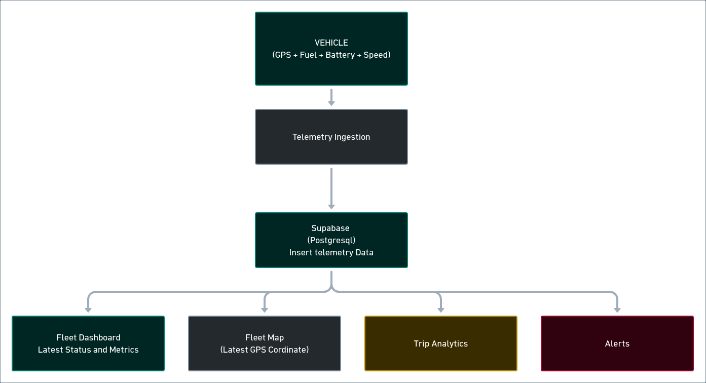

# Fleet Management Dashboard



[Product Walkthrough](https://res.cloudinary.com/dvnrlqqpq/video/upload/v1793783997/bytebeam-intern_llcctx.mp4)


A focused operational interface for monitoring fleet activity,
inspecting vehicles and trips, and reviewing operational alerts.

## Table of Contents

-   [Project Overview](#project-overview)
-   [Product Structure](#product-structure)
    -   [Overview](#overview)
    -   [Vehicles](#vehicles)
    -   [Trips](#trips)
    -   [Alerts](#alerts)
-   [Intended Operations-User
    Workflow](#intended-operations-user-workflow)
-   [Live Demo](#live-demo)
-   [Local Setup](#local-setup)
-   [Supabase Setup](#supabase-setup)
    -   [Database Tables](#database-tables)
    -   [Relationships](#relationships)
    -   [Authentication](#authentication)
-   [Technical Decisions](#technical-decisions)
-   [Data Model Decisions](#data-model-decisions)
-   [Map Library Choice](#map-library-choice)
-   [AI Usage](#ai-usage)

------------------------------------------------------------------------

## Project Overview

I've built a focused fleet-management interface designed to make
day-to-day fleet monitoring straightforward for operators and fleet
managers.

The dashboard brings together fleet-level metrics, vehicle information,
trip history, map-based tracking, telemetry, and alerts. The goal is to
help an operations user understand the current state of the fleet,
investigate unusual activity, and identify vehicles that may require
attention.

## Product Structure

The product is divided into four main sections.

### 1. Overview

The Overview page is the main dashboard and provides a high-level
picture of fleet activity.

It includes:

-   A live fleet map showing vehicle locations.
-   Key fleet metrics and operational statistics.
-   Alerts that may require attention.
-   Recent trips and fleet activity.

This page is intended to give the operator a quick understanding of the
overall fleet status as soon as they log in.

### 2. Vehicles

The Vehicles section provides fleet-wide vehicle information and
detailed views for individual vehicles.

The section includes:

-   **Fleet statistics:** total, moving, and parked vehicles, along with
    vehicle-related alerts.
-   **Vehicle details:** operational information and live metrics such
    as odometer reading, speed, ignition state, and engine temperature.
-   **Current trip:** the route of the vehicle's active trip, when one
    is in progress.
-   **Trip history:** a timeline of the vehicle's previous trips.
-   **Vehicle documents:** relevant documents associated with the
    vehicle.
-   **Driver information:** the assigned driver's contact number and
    duty hours, with an option to contact the driver directly.
-   **Vehicle alerts:** alerts associated with the selected vehicle.
-   **Telemetry:** time-based readings such as speed, temperature, and
    fuel level.

### 3. Trips

The Trips section focuses on trip-level information and historical
activity.

It includes:

-   Summary metrics such as total trips, average trip distance, and
    total distance covered.
-   A list of trips with filtering options.
-   A mini map for viewing the route associated with an individual trip.

### 4. Alerts

The Alerts section provides a central place to review operational
alerts.

It allows the operator or fleet manager to:

-   View alerts by state, including open and resolved alerts.
-   Identify high-priority alerts.
-   Review the alert type and current state.
-   Find the vehicle associated with an alert and investigate it
    further.

## Intended Operations-User Workflow

The application is designed around the following operational workflow.

1.  **Log in and access the dashboard**\
    The user authenticates through Supabase Auth and enters the
    protected dashboard.

2.  **Get an overview of the fleet**\
    The user immediately sees how many vehicles are moving, idle, or
    offline, and how many require attention.

3.  **Inspect vehicles on the map**\
    The user identifies vehicle locations on the fleet map and selects
    individual vehicles to inspect their current operational state.

4.  **Investigate vehicle activity**\
    The user reviews recent trips, routes, distance travelled, speed,
    and stoppages to understand vehicle activity.

5.  **Investigate anomalies**\
    The user looks for issues such as overspeeding, low fuel, unexpected
    inactivity, or other vehicle-health concerns.

6.  **Take operational action**\
    The user acknowledges alerts, inspects relevant trip details, and
    determines which vehicles require follow-up.

## Live Demo

-   **Deployed URL:** https://bytebeam-intern.vercel.app/
-   **Demo email:** `demo@support.com`
-   **Demo password:** `admin123`

> These are demo credentials. Do not reuse this password for a personal
> or production account.

## Local Setup

### Prerequisites

-   Node.js and npm
-   A Supabase project
-   A Mapbox access token

### 1. Clone the repository

``` bash
git clone <repository-url>
cd <project-directory>
```

### 2. Install dependencies

``` bash
npm install
```

### 3. Configure environment variables

Create a `.env.local` file in the project root and add the required
variables:

``` env
NEXT_PUBLIC_SUPABASE_URL=
NEXT_PUBLIC_SUPABASE_PUBLISHABLE_KEY=
SUPABASE_SERVICE_ROLE_KEY=
MAPBOX_ACCESS_TOKEN=
NEXT_PUBLIC_MAPBOX_ACCESS_TOKEN=
```

Use the appropriate Supabase and Mapbox values from your projects.

**Security note:** `SUPABASE_SERVICE_ROLE_KEY` is a privileged secret.
It must only be used in trusted server-side code and must never be
exposed to the browser, committed to version control, or prefixed with
`NEXT_PUBLIC_`. The publishable key is intended for client-side use with
correctly configured Row Level Security (RLS).

### 4. Set up Supabase

Follow the [Supabase Setup](#supabase-setup) instructions below. Apply
the database migrations and seed the database before starting the
application.

### 5. Run the development server

``` bash
npm run dev
```

Open the local URL printed by Next.js in your terminal.

## Supabase Setup

The application uses Supabase PostgreSQL for data storage and Supabase
Auth for email/password authentication.

### Database Tables

The database is organized around six main tables:

  -----------------------------------------------------------------------
  Table                               Purpose
  ----------------------------------- -----------------------------------
  `profiles`                          Stores profiles for authenticated
                                      dashboard users.

  `drivers`                           Stores driver information.

  `vehicles`                          Stores vehicle records and their
                                      latest operational state.

  `trips`                             Stores historical and ongoing trip
                                      records.

  `telemetry`                         Stores GPS coordinates and vehicle
                                      sensor readings.

  `alerts`                            Stores operational events,
                                      warnings, and their states.
  -----------------------------------------------------------------------

### Relationships

#### Primary keys

Each of the main tables has an `id` primary key:

-   `profiles.id`
-   `drivers.id`
-   `vehicles.id`
-   `trips.id`
-   `telemetry.id`
-   `alerts.id`

#### Foreign keys

The main relationships are:

-   `profiles.id` references the corresponding authenticated user in
    Supabase Auth (`auth.users`).
-   `vehicles.driver_id` references `drivers.id`.
-   `telemetry.trip_id` references `trips.id`.
-   `telemetry.vehicle_id` references `vehicles.id`.
-   `alerts.vehicle_id` references `vehicles.id`.
-   `alerts.trip_id` references `trips.id`.

The `trip_id` relationship on telemetry and alerts associates those
records with a trip where applicable.

### Authentication

The application uses Supabase email/password authentication.

#### Initial setup

1.  Create a new project in the Supabase dashboard.
2.  Enable email authentication in the project's Authentication
    settings.
3.  Configure the application with the Supabase project URL and
    publishable key.
4.  Add the required Supabase client and server configuration to the
    Next.js application.
5.  Configure the appropriate authentication redirect URLs for the local
    and deployed application.
6.  Apply the database migrations.
7.  Enable and configure RLS policies for the tables.
8.  Run the seed script to populate the database with sample data.

After setup, users can sign up through the application. A demo account
is also provided in the [Live Demo](#live-demo) section.

#### Environment variables

The Supabase-related variables are:

``` env
NEXT_PUBLIC_SUPABASE_URL=
NEXT_PUBLIC_SUPABASE_PUBLISHABLE_KEY=
SUPABASE_SERVICE_ROLE_KEY=
```

You can find the project URL and publishable key in the Supabase project
settings.

If server-side operations require the service role key, retrieve it from
the Supabase API keys settings and configure it only in the server
environment. Never expose it in client-side code. RLS should remain
enabled, with policies that grant only the access required by the
application.

#### Seed data

After applying the migrations, run:

``` bash
npm run seed
```

This populates the database with sample data for the prototype.

## Technical Decisions

### 1. Determining whether a vehicle is offline

A vehicle should not automatically be considered offline just because
its ignition is off. Ignition state and connectivity are different
signals.

For this prototype, vehicle states are interpreted as follows:

-   **Moving:** ignition is on and speed is greater than zero.
-   **Idle:** ignition is on and speed is approximately zero.
-   **Offline:** no telemetry has been received within a configurable
    period, such as five minutes.

The offline threshold can be adjusted based on the expected telemetry
reporting interval.

### 2. Storing GPS readings

Historical GPS readings are stored because they are required to
reconstruct a vehicle's actual trip route.

For example, if 20 vehicles each report telemetry every 30 seconds:

-   Each vehicle sends 2 readings per minute.
-   The fleet generates 40 readings per minute.
-   This results in approximately 2,400 telemetry records per hour.

That volume is manageable for this prototype.

### 3. Storing or calculating trip metrics

Metrics such as distance, average speed, maximum speed, and idle
duration can be calculated from telemetry data.

For this prototype, storing aggregated metrics in the `trips` table
makes dashboard queries simpler. These values can be calculated when a
trip is completed or generated as part of the seed process.

### 4. Vehicle assignment history

A separate vehicle-assignment history table is not included in the
current prototype.

Instead:

-   `vehicles.driver_id` represents the vehicle's current driver
    assignment.
-   `trips.driver_id` preserves the driver associated with each
    historical trip.

A dedicated assignment-history table could be introduced in a more
mature fleet-management system, but it is not required for the current
scope.

### 5. Technology stack

  Layer            Technology
  ---------------- ----------------------------
  Frontend         Next.js
  Styling and UI   Tailwind CSS and shadcn/ui
  Database         Supabase PostgreSQL
  Authentication   Supabase Auth
  Maps             Mapbox GL JS
  Deployment       Vercel

## Data Model Decisions

### 1. Trip endpoints and route reconstruction

The `trips` table stores the start and end locations of each trip,
including their latitude and longitude. These endpoints are useful for
displaying start and end markers on the map.

To reconstruct the complete route, the application stores GPS
coordinates in the `telemetry` table at regular intervals. The ordered
telemetry points are used to draw the route between the trip's start and
end locations.

The following query retrieves the GPS coordinates and speed readings for
a particular trip:

``` sql
SELECT
    latitude,
    longitude,
    speed,
    recorded_at
FROM telemetry
WHERE trip_id = '<trip_id>'
ORDER BY recorded_at ASC;
```

The returned coordinates can be converted into a GeoJSON `LineString`
and rendered on the map. The order of the points is important because it
determines the path of the route.

### 2. Associating alerts with vehicles and trips

The `alerts` table contains both `vehicle_id` and `trip_id` foreign
keys.

-   `vehicle_id` identifies the vehicle associated with the alert.
-   `trip_id` links the alert to a particular trip when the alert is
    trip-related.

This makes it possible to retrieve alerts for a vehicle and, where
applicable, display them in the context of the trip during which they
occurred.

## Map Library Choice

The application uses [Mapbox](https://www.mapbox.com/) for fleet
tracking and map visualization.

Mapbox provides customizable maps and APIs for mapping-related
functionality. It is used in the application to visualize vehicle
locations and trip routes.

### Historical route rendering

The recorded GPS points are treated as the source of truth for
historical trip routes. Map Matching is used to improve how those
recorded routes appear by aligning GPS traces with the road network.

The Directions API does not need to be called every time a user opens a
historical trip. The application can retrieve the stored GPS points and
render the route, using Map Matching where appropriate.

### Map views

The application includes three map views:

1.  **Fleet Overview:** displays the fleet's vehicle locations.
2.  **Trip Inspection:** displays the route and details of a selected
    trip.
3.  **Vehicle Inspection:** displays the selected vehicle's location and
    relevant trip route, where applicable.

## AI Usage

### Tools used

-   **Manus:** assisted with designing the application pages.
-   **Antigravity:** assisted with AI-supported coding.
-   **ChatGPT:** helped interpret and understand the product
    requirements.

### How AI-generated output was reviewed

AI-generated designs and code were manually reviewed against the product
requirements and the intended user experience. The output was checked
for alignment with the application's scope and requirements before being
incorporated into the project.

Chat logs -> https://chatgpt.com/c/6ae86bd5-d2ac-83ee-8b92-96f57474f64b
Manus AI Link - https://manus.im/share/dB65nnjtvcIlZQFbw4O5ni

------------------------------------------------------------------------
